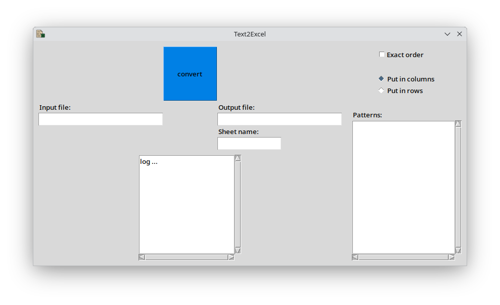

# Text2Excel

**Text2Excel** is a desktop GUI application that extracts data from text files and saves them into Excel or CSV files using regular expression (regex) patterns. It is built with Python’s `re` module.



## Features
- Add regex patterns via the **patterns widget** (right-click → context menu).  
- Choose whether data goes into **columns** or **rows**, and select the target sheet.  
- **Exact Order** option:  
  - Disabled → places data starting from the last filled row in the file.  
  - Enabled → aligns data strictly with existing entries (only in “put in columns” mode).  
- Support for regex **groups**:  
  - Example:  
    ```regex
    \w{5}(\d)
    ```  
    This matches 5 word characters followed by a digit, but only the digit will be saved if wrapped in a group.  
- Export to **Excel (.xlsx)** or **CSV (.csv)** (CSV available via the output file context menu).
- **Batch mode**: put a directory in the *Input file/folder* entry (right-click it → **Browse folder**) and press *convert*. Every text file in that directory is processed in turn with the current pattern list, and all matches are appended to a single output file.
  - Failures are isolated: an unreadable file (binary, bad encoding, no permission) or an illegal pattern is skipped and reported, while every other file and pattern still runs.
  - Already written data is never rolled back. In batch mode the workbook is opened and saved exactly once (the CSV file is opened once).
  - The log lists, per file, how many values were written or why the file was skipped, and ends with the number of successful and failed files. An empty directory or a run with no matches produces an explicit message instead of ending silently.

**note: You cannot place multiple groups in one pattern**

## Installation
This project requires `openpyxl`. Install it with:

```bash
python -m pip install openpyxl
```

Version used during development:
```bash
python -m pip install openpyxl==3.1.5
```

Run the app with:
```bash
python src/text2excel.py
```

## Tests
The test suite covers normal batch extraction, bad-file skipping, illegal-regex
skipping, empty directories, no-match runs and the original single-file behaviour:
```bash
python -m pytest tests/
```
## Build
To build an executable with `pyinstaller`:
```bash
cd build
pyinstaller text2excel.spec
```

Install `pyinstaller` if needed:
```bash
pip install pyinstaller
```

## License

This project is licensed under the [MIT License](LICENSE).


[def]: assets/screenshot.png