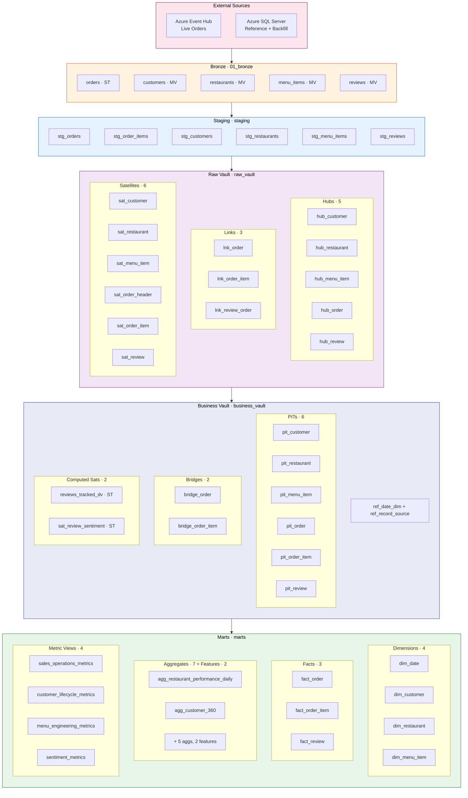
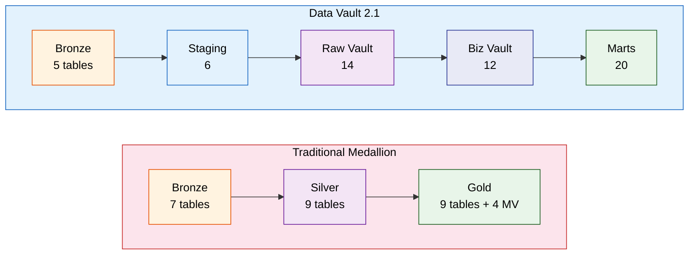
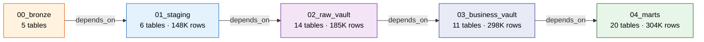

# Data Vault 2.1 — Restaurant Chain Analytics Platform

> A production-grade Data Vault 2.1 implementation on Databricks, re-architecting the [Restaurant Chain Lakehouse Analytics](https://github.com/mdshihabullah/restaurant-chain-lakehouse-analytics) from a traditional Medallion pattern to a hub-and-spoke vault design for auditability, scalability, and agility.

[](https://databricks.com)
[](https://datavaultalliance.com)
[](https://docs.databricks.com/data-governance/unity-catalog/index.html)
[](https://azure.microsoft.com)

---

## Table of Contents

1. [Architecture Overview](#1-architecture-overview)
2. [Traditional vs Data Vault — Side by Side](#2-traditional-vs-data-vault--side-by-side)
3. [Why Data Vault 2.1?](#3-why-data-vault-21)
4. [Layer-by-Layer Breakdown](#4-layer-by-layer-breakdown)
5. [Pipeline Orchestration](#5-pipeline-orchestration)
6. [Data Quality](#6-data-quality)
7. [Dashboards](#7-dashboards)
8. [Data Profile](#8-data-profile)
9. [Deployment & CI/CD](#9-deployment--cicd)
10. [Quick Reference](#10-quick-reference)

---

## 1. Architecture Overview



**Legend**: ST = Streaming Table · MV = Materialized View

> Ghost records: `dim_customer` (505 = 504 real + 1 UNKNOWN), `dim_restaurant` (7 = 6 real + 1 UNKNOWN) — DV 2.1 best practice for late-arriving data.

**52 tables** across 6 schemas · **935,826 total rows** · All materialized views except 3 streaming tables (1 Event Hub landing + 2 AI enrichment)

---

## 2. Traditional vs Data Vault — Side by Side

This project re-implements the [Restaurant Chain Lakehouse Analytics](https://github.com/mdshihabullah/restaurant-chain-lakehouse-analytics) using Data Vault 2.1. Both produce **identical analytical output** — same 7 aggregates, 2 feature tables, and 4 metric views.



| Aspect | Traditional Medallion | Data Vault 2.1 |
| --- | --- | --- |
| **Layers** | Bronze → Silver → Gold | Bronze → Staging → Raw Vault → Business Vault → Marts |
| **Change tracking** | SCD2 via `create_auto_cdc_from_snapshot_flow` | Append-only satellites with SHA-256 hash-diff |
| **Schema evolution** | `ALTER TABLE` or recreate pipeline | Add new satellite — existing tables untouched |
| **Audit trail** | Overwritten by SCD2 updates | Full history preserved in every satellite row |
| **Source integration** | One pipeline per source | Multiple sources feed same hubs via `UNION ALL` |
| **Query acceleration** | Temp views recomputed each run | Pre-joined PITs and Bridges (materialized) |
| **Referential integrity** | Foreign key expectations | Hash-key based joins — no FK constraints needed |
| **Mart output** | 7 gold aggregates, 2 feature tables, 4 metric views | Identical: 7 aggs, 2 features, 4 metric views |

> **More objects, but each is single-purpose and independently evolvable.** A hub is 4 columns. A satellite is FK + hash_diff + metadata + attributes. No table has mixed concerns.

---

## 3. Why Data Vault 2.1?

### 3.1 Scalability: Adding a New Source Without Breaking Anything

**Scenario**: A loyalty program system starts sending customer tier data.

**Traditional Medallion** — must modify existing dimension, retrigger SCD2, risk breaking downstream:

```sql
-- Traditional: Must ALTER existing table + update CDC flow + redeploy + retest
ALTER TABLE restaurant_chain_db.`02_silver`.dim_customers
ADD COLUMNS (loyalty_tier STRING, loyalty_points INT);

-- Then modify create_auto_cdc_from_snapshot_flow to capture new columns
-- Risk: All downstream gold tables re-process; schema change may break consumers
```

**Data Vault** — add one satellite, zero changes to anything else:

```sql
-- Data Vault: New satellite. hub_customer, sat_customer, all links → UNCHANGED.
CREATE OR REPLACE TABLE restaurant_chain_db.raw_vault.sat_customer_loyalty (
  hk_customer    STRING NOT NULL,   -- FK → hub_customer (same hash key)
  hash_diff      STRING NOT NULL,   -- SHA-256 of descriptive attributes
  load_dts       TIMESTAMP NOT NULL,
  record_source  STRING NOT NULL,
  loyalty_tier   STRING,
  loyalty_points INT
);

-- Existing hub_customer, sat_customer, lnk_order, bridge_order → ZERO CHANGES
-- pit_customer picks up new columns via one additional LEFT JOIN
-- Marts add the column to dim_customer SELECT — nothing else recompiles
```

**Why this matters**: In a production warehouse with 20+ consumers, altering `dim_customers` triggers full SCD2 recomputation and requires downstream validation. Adding a satellite is **additive** — nothing existing is touched, nothing can break.

### 3.2 Auditability: Point-in-Time State for Any Entity

```sql
-- Data Vault: "What was customer C001's city on 2025-10-15?"
SELECT h.customer_id, p.city, p.effective_from, p.effective_to
FROM restaurant_chain_db.raw_vault.hub_customer h
JOIN restaurant_chain_db.business_vault.pit_customer p
  ON h.hk_customer = p.hk_customer
WHERE h.customer_id = 'C001'
  AND p.effective_from <= '2025-10-15'
  AND (p.effective_to IS NULL OR p.effective_to > '2025-10-15');

-- Traditional: Requires querying SCD2 platform-managed __START_AT / __END_AT
-- columns, which couple your query logic to Databricks-specific CDC internals.
```

The Data Vault PIT table uses explicit `effective_from` / `effective_to` columns that **you control**, not platform-managed SCD2 markers.

### 3.3 Query Performance: Bridge Tables Eliminate Repeated Joins

**Traditional** — every analytics query must re-join facts with multiple SCD2 dimensions:

```sql
-- Traditional: 4-way join + SCD2 currency filter on every query
SELECT o.order_id, c.customer_id, r.restaurant_name, r.city
FROM restaurant_chain_db.`02_silver`.fact_orders o
JOIN restaurant_chain_db.`02_silver`.dim_customers c
  ON o.customer_id = c.customer_id AND c.__END_AT IS NULL
JOIN restaurant_chain_db.`02_silver`.dim_restaurants r
  ON o.restaurant_id = r.restaurant_id AND r.__END_AT IS NULL;
-- Add dim_menu_items for item details → 5-way join
-- Every gold aggregate repeats this same pattern
```

**Data Vault** — bridge pre-resolves the relationship at load time:

```sql
-- Data Vault: bridge_order already resolved order ↔ customer ↔ restaurant
SELECT b.order_id, b.customer_id, b.restaurant_id,
       p.order_type, p.total_amount, p.payment_method
FROM restaurant_chain_db.business_vault.bridge_order b
JOIN restaurant_chain_db.business_vault.pit_order p
  ON b.hk_order = p.hk_order
WHERE p.effective_to IS NULL;
-- 2-way join instead of 4-way. Bridge is materialized and clustered by hk_order.
```

This is exactly how `fact_order` in our marts layer is built — it joins `bridge_order` + `pit_order` + dimensions, leveraging the pre-resolved bridge.

---

## 4. Layer-by-Layer Breakdown

### 4.0 Bronze (5 tables)

Ingests external sources into Unity Catalog. Azure Event Hub provides live streaming orders; Azure SQL Server provides reference data (customers, restaurants, menu items) and historical backfill.

| Table | Type | Source | Description |
| --- | --- | --- | --- |
| `orders` | ST | Azure Event Hub | Live order stream (JSON → structured) |
| `customers` | MV | Azure SQL Server | Customer reference data |
| `restaurants` | MV | Azure SQL Server | Restaurant reference data |
| `menu_items` | MV | Azure SQL Server | Menu item catalog |
| `reviews` | MV | Azure SQL Server | Customer reviews |

**Data sources**:
- **Azure Event Hub** (namespace and topic configured via bundle variables `eh_namespace` and `eh_name`) — streaming orders ingested via Spark structured streaming. Connection string stored in Databricks secrets scope.
- **Azure SQL Server** (hostname and database configured via bundle variables `sql_host_name` and `sql_db_name`) — JDBC reads for reference and backfill tables. Credentials stored in Databricks secrets scope.

### 4.1 Staging (6 tables)

Computes SHA-256 hash keys and hash-diffs on bronze data. Virtual preparation layer — no business logic.

| Table | Source | Hash Keys Computed | DQ |
| --- | --- | --- | --- |
| `stg_orders` | `01_bronze.orders` | hk_order, hk_customer, hk_restaurant, hk_lnk_order | `expect_all_or_fail` |
| `stg_order_items` | `01_bronze.orders` (exploded) | hk_order, hk_menu_item, hk_lnk_order_item | `expect_all_or_fail` |
| `stg_customers` | `01_bronze.customers` | hk_customer | `expect_all_or_fail` |
| `stg_restaurants` | `01_bronze.restaurants` | hk_restaurant | `expect_all_or_fail` |
| `stg_menu_items` | `01_bronze.menu_items` | hk_menu_item (composite: restaurant_id + item_id) | `expect_all_or_fail` |
| `stg_reviews` | `01_bronze.reviews` | hk_review, hk_order, hk_lnk_review_order | `expect_all_or_fail` |

**Hashing specification** (from `_dv_hash.py`):

| Property | Value |
| --- | --- |
| **Algorithm** | SHA-256 (64-char hex) |
| **Salt** | `RESTAURANT_CHAIN` (prepended to hash keys; omitted for hash-diff) |
| **Delimiter** | `\|\|` between concatenated columns |
| **NULL handling** | `COALESCE(UPPER(TRIM(col)), '^^')` |

### 4.2 Raw Vault (14 tables)

**5 Hubs** — one row per unique business key, insert-only:

| Hub | Business Key | Sources |
| --- | --- | --- |
| `hub_customer` | customer_id | stg_customers, stg_orders |
| `hub_restaurant` | restaurant_id | stg_restaurants, stg_orders |
| `hub_menu_item` | (restaurant_id, item_id) | stg_menu_items, stg_order_items |
| `hub_order` | order_id | stg_orders |
| `hub_review` | review_id | stg_reviews |

**3 Links** — relationships between hubs:

| Link | Relationship | Hub FKs |
| --- | --- | --- |
| `lnk_order` | order ↔ customer ↔ restaurant | hk_order, hk_customer, hk_restaurant |
| `lnk_order_item` | order ↔ menu_item | hk_order, hk_menu_item |
| `lnk_review_order` | review ↔ order | hk_review, hk_order |

**6 Satellites** — descriptive attributes with hash-diff change detection:

| Satellite | Parent | Attributes |
| --- | --- | --- |
| `sat_customer` | hub_customer | name, email, phone, city, join_date |
| `sat_restaurant` | hub_restaurant | name, city, country, address, opening_date, phone |
| `sat_menu_item` | hub_menu_item | name, category, price, ingredients, is_vegetarian, spice_level |
| `sat_order_header` | hub_order | order_timestamp, order_type, total_amount, payment_method, order_status |
| `sat_order_item` | lnk_order_item | line_number, item_name, item_category, quantity, unit_price, subtotal |
| `sat_review` | hub_review | review_text, rating, review_timestamp |

### 4.3 Business Vault (11 tables)

| Type | Tables | Purpose |
| --- | --- | --- |
| **Reference (2)** | `ref_date_dim`, `ref_record_source` | Calendar dimension + DV 2.1 record source registry |
| **PITs (6)** | pit_customer, pit_restaurant, pit_menu_item, pit_order, pit_order_item, pit_review | Satellite versions with `effective_from` / `effective_to` |
| **Bridges (2)** | bridge_order, bridge_order_item | Pre-joined hub relationships → natural keys |
| **Computed Sats (2)** | reviews_tracked_dv (ST), sat_review_sentiment (ST) | CDC + `ai_query` for process-once AI sentiment |

**Design choice — Lean PIT pattern**: One row per satellite version (e.g., `pit_customer` = 504 rows) instead of one row per key per calendar date (which would produce 184K+ rows/year). Computed via `LEAD(load_dts) OVER (PARTITION BY hk)`.

### 4.4 Marts (20 tables)

| Type | Count | Tables |
| --- | --- | --- |
| **Dimensions** | 4 | dim_date, dim_customer (with ghost), dim_restaurant (with ghost), dim_menu_item |
| **Facts** | 3 | fact_order, fact_order_item, fact_review |
| **Aggregates** | 7 | agg_restaurant_performance_daily, agg_customer_360, agg_menu_item_performance_monthly, agg_review_insights_monthly, agg_business_monthly_base, agg_business_performance_trends, agg_menu_item_ranked_monthly |
| **Features** | 2 | feat_customer_features, feat_restaurant_demand_features |
| **Metric Views** | 4 | sales_operations_metrics, customer_lifecycle_metrics, menu_engineering_metrics, sentiment_metrics |

**Mart construction pattern**: Facts join **Bridges** (relationship keys) + **PITs** (current attributes) + **Dimensions** (denormalized names). Example from `fact_order.py`:

```
bridge_order ⨝ pit_order ⨝ dim_restaurant ⨝ dim_customer ⨝ bridge_order_item (count)
```

---

## 5. Pipeline Orchestration

**Job**: `datavault_full_pipeline` · Schedule: Daily 6:00 AM (Asia/Dubai)



| Task | Pipeline Name | Schema | Tables | Rows |
| --- | --- | --- | --- | --- |
| 00_bronze_ingestion | `datavault_bronze_ingestion` | `01_bronze` | 5 | — |
| 01_staging | `datavault_staging` | `staging` | 6 | 148,511 |
| 02_raw_vault | `datavault_raw_vault` | `raw_vault` | 14 | 185,464 |
| 03_business_vault | `datavault_business_vault` | `business_vault` | 12 | 297,999 |
| 04_marts | `datavault_marts` | `marts` | 20 | 303,852 |
| **Total** | | | **57** | **935,826+** |

> **Note**: Pipeline IDs are managed by DABs and change with each deployment. Reference pipelines by **name** in the Pipelines UI. All pipelines run in serverless mode with Photon enabled.

---

## 6. Data Quality


| Layer | Action | Rules |
| --- | --- | --- |
| **Bronze** | Schema validation | JSON parsing, type coercion, null handling |
| **Staging** | `expect_all_or_fail` | PK NOT NULL (order_id, customer_id, restaurant_id, etc.) |
| **Raw Vault** | `expect_all_or_fail` | Hash key NOT NULL, `LENGTH(hk) = 64`, business key NOT NULL, load_dts NOT NULL |
| **Business Vault** | `expect_all_or_fail` + `expect` | Hash key FKs NOT NULL, effective_from NOT NULL; date ordering (warn) |
| **Marts — Facts** | `expect_all_or_drop` + `expect` | PK/FK NOT NULL (drop); business rules like `total_amount >= 0` (warn) |
| **Marts — Aggs** | `expect` (warn) | Sanity: `total_orders > 0`, `total_revenue >= 0` |

**Known DQ observations**:

| Observation | Detail |
| --- | --- |
| Ghost records | dim_customer: 505 rows (504 + 1 UNKNOWN), dim_restaurant: 7 rows (6 + 1 UNKNOWN) |
| Orphan reviews | 2 reviews reference non-existent orders → dropped by INNER JOIN in fact_review (82 vs 84) |
| AI sentiment | 84/84 reviews processed by `ai_query` (100% coverage) |

---


---

## 6.1 Governance — Unity Catalog Tags & Column Comments

All governance metadata is applied via `scripts/set_tags_for_governance.sql` — run once after initial pipeline deployment, then after any schema changes.

### Schema-Level Tags

| Schema | `layer` | `data_owner` |
| --- | --- | --- |
| `01_bronze` | bronze | data-engineering |
| `staging` | staging | data-engineering |
| `raw_vault` | raw_vault | data-engineering |
| `business_vault` | business_vault | data-engineering |
| `marts` | marts | analytics |

### Table-Level Tags

Every table carries two tags:

| Tag | Values | Purpose |
| --- | --- | --- |
| `pii` | `false`, `masked_sha256`, `potential` | PII classification |
| `data_classification` | `public`, `internal`, `confidential` | Data sensitivity level |

**PII-tagged tables**: `01_bronze.customers` (masked), `raw_vault.sat_customer` (masked), `raw_vault.sat_review` (potential — free text), `business_vault.pit_customer` (masked), `marts.dim_customer` (masked).

### Column-Level PII Tags

PII columns in `01_bronze.customers` and `raw_vault.sat_customer` carry `pii_type` and `masking` tags:

| Column | `pii_type` | `masking` |
| --- | --- | --- |
| `name` | person_name | sha256 |
| `email` | email | sha256 |
| `phone` | phone | sha256 |

### Column Comments

Key columns in hubs, satellites, facts, and feature tables have descriptive `COMMENT ON COLUMN` definitions for data catalog discoverability.

### Performance: Liquid Clustering & Delta Retention

All vault and mart tables (hubs, satellites, links, PITs, bridges, facts, features) are configured with:
- **Liquid clustering** (`cluster_by`) on primary/foreign key columns for optimal query performance
- **Delta retention** (`deletedFileRetentionDuration: 30 days`, `logRetentionDuration: 90 days`) to control storage costs while supporting time travel

### Record Source Registry

`business_vault.ref_record_source` — a DV 2.1 governance reference table mapping all `record_source` codes (e.g., `BRONZE_ORDERS`, `BRONZE_CUSTOMERS`) to their source system, data owner, SLA, and classification. Eliminates tribal knowledge for auditability.

---

## 7. Dashboards

5 AI/BI dashboards sourced from marts metric views and aggregate tables:

| Dashboard | Pages | Widgets | Key Metrics |
| --- | --- | --- | --- |
| **DV_Executive Business Overview** | 2 | 23 | AED 6.56M revenue · 36,961 orders · AOV AED 177.45 |
| **DV_Sales & Operations Analytics** | 2 | 19 | Channel mix · payment mix · 66.5% digital payment |
| **DV_Customer Intelligence & Segmentation** | 2 | 22 | 503 customers · AED 13,039 avg LTV · 82 reviews |
| **DV_Menu Engineering & Product Performance** | 2 | 16 | 30 items · Lamb Rogan Josh top seller · 59.5% vegetarian |
| **DV_Data Pipeline & Quality Health** | 2 | 17 | 51 DV tables · layer monitoring · data freshness |

---

## 8. Data Profile

| Metric | Value |
| --- | --- |
| **Customers** | 503 (504 in vault + 1 ghost record) |
| **Restaurants** | 6 (5 active branches + 1 test) |
| **Cities** | Dubai, Abu Dhabi, Sharjah |
| **Menu Items** | 30 unique items |
| **Total Orders** | 36,961 |
| **Total Revenue** | AED 6,558,708 |
| **Reviews** | 82 (84 in bronze, 2 orphans dropped by INNER JOIN) |
| **Date Range** | Aug 2025 — Apr 2026 |

---

## 9. Deployment & CI/CD

The project is deployed as a **Databricks Declarative Automation Bundle (DABs)**, with GitHub Actions for continuous delivery.

### 9.1 Repository Structure

```
restaurant-chain-datavault-analytics/
├── databricks.yml                              # Bundle config (variables, targets)
├── .gitignore
├── resources/                                  # DABs resource definitions
│   ├── bronze_pipeline.yml                     # Event Hub + SQL Server → 01_bronze
│   ├── staging_pipeline.yml                    # Hash keys + metadata → staging
│   ├── raw_vault_pipeline.yml                  # Hubs, links, satellites → raw_vault
│   ├── business_vault_pipeline.yml             # PITs, bridges, computed sats → business_vault
│   ├── marts_pipeline.yml                      # Dims, facts, aggs, features → marts
│   ├── orchestration_job.yml                   # 5-task sequential job
│   └── dashboards.yml                          # 5 AI/BI dashboards
├── src/
│   ├── bronze/transformations/                 # 9 files (landing + bronze MVs)
│   ├── staging/transformations/                # 7 files (incl. _dv_hash.py)
│   ├── raw_vault/transformations/              # 14 files (hubs, links, sats)
│   ├── business_vault/transformations/         # 11 files (ref, pit, bridge, computed)
│   ├── marts/transformations/                  # 16 files (dim, fact, agg, feat)
│   ├── dashboards/                             # 5 .lvdash.json files
│   └── metric_views/                           # 4 metric view YMLs
├── docs/
│   ├── datavault_general_readme.md             # This file
│   └── datavault_runbook.md                    # Operational runbook
└── .github/workflows/
    └── deploy.yml                              # GitHub Actions CI/CD
```

### 9.2 Bundle Architecture

`databricks.yml` defines all infrastructure as variables with sensible defaults. Only workspace-specific values (`warehouse_id`) require external input:

```
Bundle Variables (databricks.yml)              Databricks Secrets Scope (runtime)
├── warehouse_id (no default, workspace-specific)  ├── eh-conn-str (Event Hub)
├── notification_email (default: "")               ├── db_admin_username (SQL Server)
├── catalog (default: restaurant_chain_db)         └── db_admin_password (SQL Server)
├── *_schema (defaults: 01_bronze, staging, ...)
├── eh_* (Event Hub namespace, name, offsets, ...)
├── sql_* (SQL Server hostname, database name)
└── secrets_scope (default: res-chain-pipeline)
```

**Key design**: No `workspace.host` in the YAML — the Databricks CLI resolves the target workspace from the `DATABRICKS_HOST` environment variable, which is already required for authentication. This makes the bundle portable across any workspace.

### 9.3 CI/CD Workflow (GitHub Actions)

On **pull request** → validate bundle. On **merge to main** → deploy to dev.

| GitHub Secret | Purpose |
| --- | --- |
| `DATABRICKS_HOST` | Workspace URL (auth + targeting) |
| `DATABRICKS_CLIENT_ID` | Service principal client ID |
| `DATABRICKS_CLIENT_SECRET` | Service principal OAuth secret |
| `NOTIFICATION_EMAIL` | Job failure alert email |
| `WAREHOUSE_ID` | SQL warehouse ID for dashboards |

Authentication uses OAuth M2M (service principal) — no personal access tokens.

### 9.4 Fresh Workspace Deployment

1. **Create catalog**: `restaurant_chain_db` with schemas `01_bronze`, `staging`, `raw_vault`, `business_vault`, `marts`
2. **Create secrets scope**: `databricks secrets create-scope res-chain-pipeline`
3. **Add runtime secrets**: `eh-conn-str`, `db_admin_username`, `db_admin_password`
4. **Create service principal** with OAuth secret, then grant permissions:
   ```sql
   -- Run as catalog admin in a SQL editor
   GRANT ALL PRIVILEGES ON CATALOG restaurant_chain_db TO `<sp-application-id>`;
   ```
   ```bash
   # Grant SP read access to secrets scope (positional args, no flags)
   databricks secrets put-acl res-chain-pipeline <sp-application-id> READ
   ```
5. **Configure GitHub secrets** (5 secrets listed above)
6. **Push to main** → GitHub Actions validates and deploys automatically

> For detailed step-by-step commands, see the [Operational Runbook](docs/datavault_runbook.md).

### Access Control Model (Group-Based)

| Group | Scope | Use Case |
| --- | --- | --- |
| `datavault-admins` | ALL PRIVILEGES on catalog | Pipeline SP, workspace admins |
| `datavault-engineers` | SELECT on all 5 schemas | Data engineers (debugging, development) |
| `datavault-analysts` | SELECT on `marts` only | Dashboard viewers, BI analysts |

Groups must be created at the **account level** (Account Console → User Management → Groups). Grants are applied in CI/CD (`deploy.yml`) after `databricks bundle deploy` — they persist across pipeline runs and only need to run once per deployment.


---

## 10. Quick Reference

### Naming Conventions

| Prefix | Meaning | Example |
| --- | --- | --- |
| `stg_` | Staging table | `stg_orders` |
| `hub_` | Hub (unique business keys) | `hub_customer` |
| `lnk_` | Link (relationship) | `lnk_order` |
| `sat_` | Satellite (descriptive attributes) | `sat_customer` |
| `pit_` | Point-in-Time | `pit_customer` |
| `bridge_` | Bridge (pre-joined relationships) | `bridge_order` |
| `ref_` | Reference table | `ref_date_dim` |
| `dim_` | Dimension | `dim_customer` |
| `fact_` | Fact | `fact_order` |
| `agg_` | Aggregate | `agg_restaurant_performance_daily` |
| `feat_` | Feature table | `feat_customer_features` |
| `hk_` | Hash key column | `hk_customer` |
| `hk_lnk_` | Link hash key column | `hk_lnk_order` |

### Schema Map

| Layer | Schema |
| --- | --- |
| Bronze | `restaurant_chain_db.01_bronze` |
| Staging | `restaurant_chain_db.staging` |
| Raw Vault | `restaurant_chain_db.raw_vault` |
| Business Vault | `restaurant_chain_db.business_vault` |
| Marts | `restaurant_chain_db.marts` |

---

*This project re-architects [Restaurant Chain Lakehouse Analytics](https://github.com/mdshihabullah/restaurant-chain-lakehouse-analytics) with Data Vault 2.1 methodology on Databricks using Spark Declarative Pipelines with Unity Catalog.*
