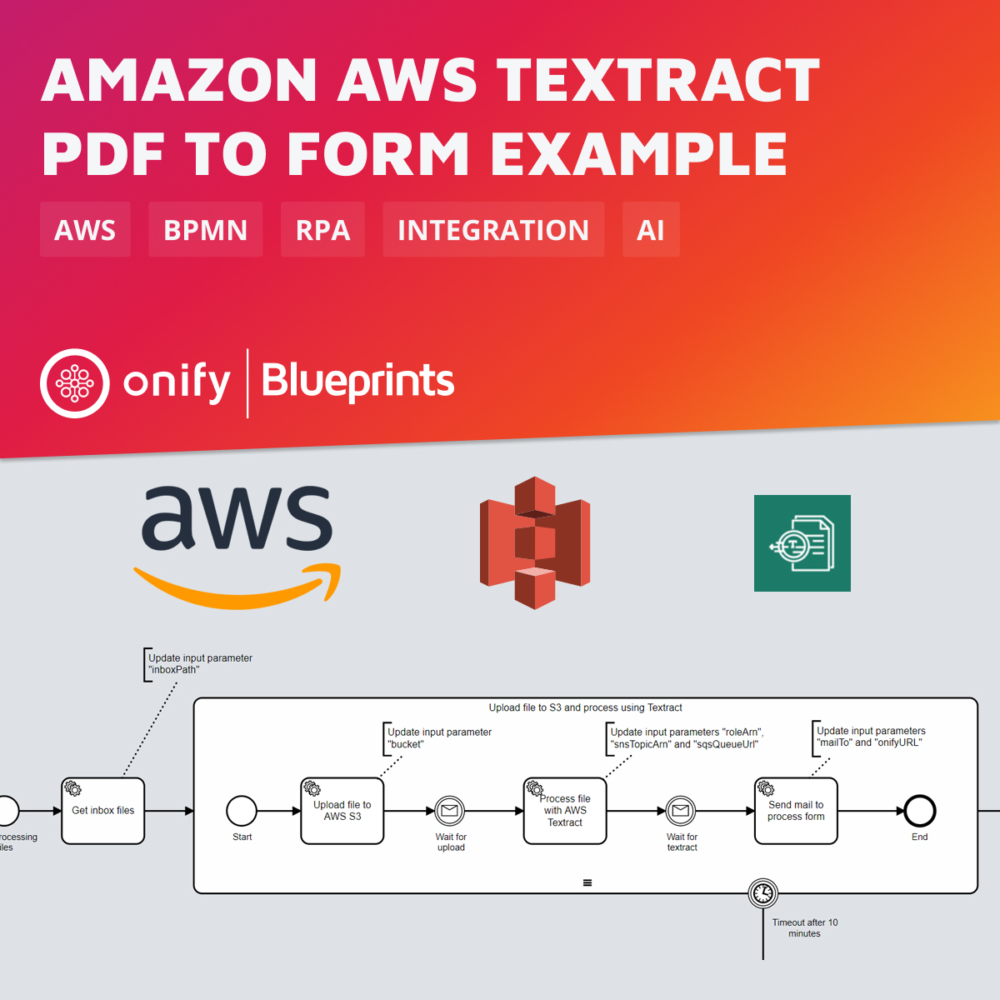
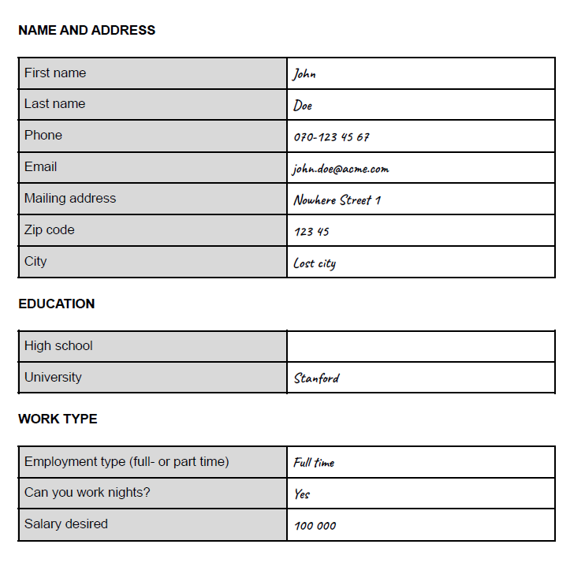
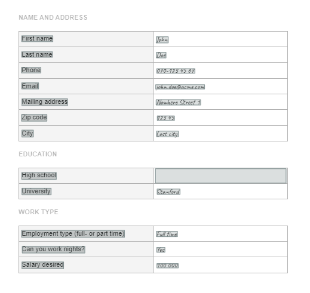
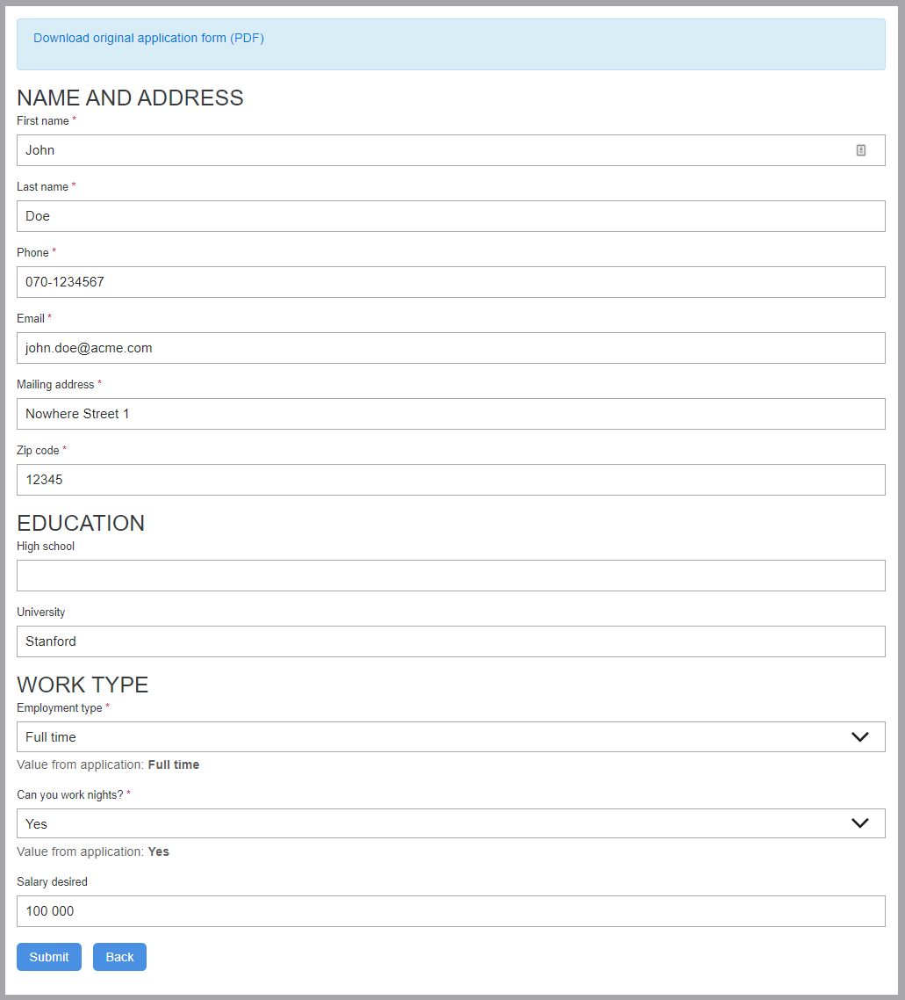
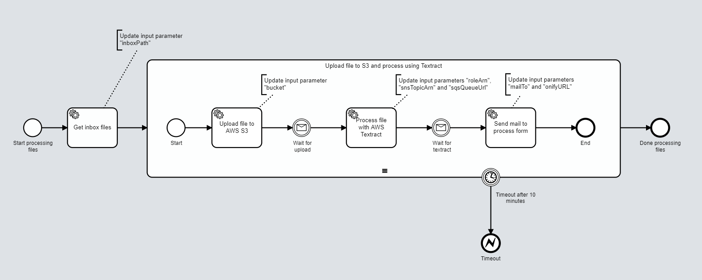

[](https://www.repostatus.org/#wip)

# Onify Blueprint: Amazon AWS Textract - PDF to form example

Example how to 1) upload files to AWS S3 and 2) process the PDF file via AWS Textract and 3) send link to form to validate data from PDF. What you need to do is decide where the data from the form should go. But that is a different story and a different Blueprint :-)

**Amazon Textract**
 
Amazon Textract is a machine learning service that automatically extracts text, handwriting and data from scanned documents that goes beyond simple optical character recognition (OCR) to identify, understand, and extract data from forms and tables. Read more: https://aws.amazon.com/textract/.




## Screenshots

### PDF

Here is a example of the PDF files that are in the "inbox".



### AWS Textract

Here is how Amazon Textract sees the PDF as a form.



### Form

Here is how the data ends up in the form in Onify.



### Onify Flow



## Requirements

* Onify Hub API 2.3.0 or later
* Mail configured in Onify Hub
* Onify Agent (tagged `agent`)
* Onify Flow license
* Node.js installed (on agent)
* Camunda Modeler 4.4 or later 
* Amazon AWS services: S3 Bucket, SNS and SQS

## Included

* 1 x Flow
* 4 x Scripts (nodejs)
* 1 x Local test suite (no AWS credentials or network required)

## How the batch is processed

Every file in the inbox is handled independently:

1. upload the file to S3 and create a signed URL
2. run asynchronous Textract analysis and wait for the SNS/SQS notification
3. send the verification mail with the form link

A failure is recorded against the file and processing continues with the next
file. Each file ends with an explicit outcome:

```json
{
  "status": "partial_failure",
  "allSucceeded": false,
  "total": 3,
  "succeeded": 1,
  "failed": 2,
  "succeededFiles": ["job-application-001.pdf"],
  "failedFiles": ["job-application-002.pdf", "job-application-003.pdf"],
  "failures": [
    {
      "fileName": "job-application-002.pdf",
      "key": "job-application-002.pdf",
      "stage": "textract",
      "operation": "getAnalysis",
      "reason": "textract failed for file=job-application-002.pdf, bucket=my-bucket, jobId=abc: INVALID_DOCUMENT"
    }
  ],
  "outcomes": [ /* full per-file detail, including uploadResult */ ]
}
```

`status` is one of:

* `success` - every file succeeded (an empty inbox is also `success`)
* `partial_failure` - at least one file succeeded and at least one failed
* `failure` - no file succeeded

Rules:

* `error.reason` always starts with the stage and the file (name/key/bucket/
  job id), so a failure can be located without guessing.
* If the upload succeeded but recognition or mail failed, the outcome keeps
  `uploadResult` (including `SignedUrl`) for troubleshooting.
* The verification mail is only sent for files that completed every stage.
* The scripts exit `0` for per-file failures so the flow can read the summary
  and continue; only batch-level problems (unreadable inbox, missing
  configuration) exit non-zero.

> Note: the agent scripts `uploadFile.js` and `processFile.js` keep their
> original argument order and their original success output. Their failures
> are now returned as the structured envelope above instead of aborting the
> agent task.

## Setup

### Amazon AWS

In order for this to work you need the following setup:

1. Amazon S3 Bucket
2. AWS user with [permissions](https://docs.aws.amazon.com/textract/latest/dg/api-async-roles.html)
3. Document access key (`accessKeyId`) and Secure Access Key for AWS user (`secretAccessKey`)

> NOTE: For more information, please read [Configuring Amazon Textract for Asynchronous Operations](https://docs.aws.amazon.com/textract/latest/dg/api-async-roles.html)

> NOTE: Amazon Textract is not available in all regions. Also make sure S3 bucket and Textract are in same region.

### Onify Agent 

* Copy files from `.\resources\agent\scripts` to `.\scripts` folder on Onify Agent.
* Run `npm install` from the `.\scripts` folder
* Update `aws_config.json` with AWS credentials and region.

The agent tasks that the flow can call are:

| Script | Arguments (unchanged from the original design) |
| --- | --- |
| `getInboxFiles.js` | `<inboxPath>` |
| `uploadFile.js` | `<fileName> <fullFileName> <bucket>` |
| `processFile.js` | `<key> <bucket> <roleArn> <snsTopicArn> <sqsQueueUrl>` |
| `processBatch.js` | `<inboxPath> <bucket> <roleArn> <snsTopicArn> <sqsQueueUrl> <mailTo> <onifyURL>` |

`processBatch.js` is the fault-isolated entry point used by the flow.

Optional environment variables:

* `ONIFY_TOKEN` - bearer token for the Onify `tools/sendmail` call (if your Hub requires one)
* `BATCH_WAIT_TIMEOUT_MS` - how long to wait for a Textract notification (default 5 minutes)
* `BATCH_POLL_DELAY_MS` - extra delay between SQS polls when it returns immediately

### Onify Flow

Update flow (`aws-textract-pdf-to-form.bpmn`) with your own variables:

* `inboxPath` - Path to the PDF files
* `bucket` - S3 bucket to upload files
* `mailTo` - Where to send the link to the form
* `onifyURL` - URL to Onify APP (default is http://localhost:3000)
* `roleArn` - The Amazon Resource Name (ARN) of an IAM role that gives Amazon Textract publishing permissions to the Amazon SNS topic
* `snsTopicArn` - The Amazon SNS topic that Amazon Textract posts the completion status to
* `sqsQueueUrl` - Amazon SQS url that is subscribed to the SNS topic

The flow's `Batch outcome` gateway routes on `batchStatus`:

* `success` -> "All files processed"
* `partial_failure` -> "Batch completed with failed files"
* `failure` / anything else (default) -> "Batch failed" (BPMN error end event)

## Test locally

The tests use in-memory doubles for upload, Textract, the SNS/SQS wait and
mail. No AWS credentials, network or Onify Hub are required.

```bash
cd resources/agent/scripts
npm test
```

The suite covers:

* per-file isolation (upload, recognition and mail failures do not abort the batch)
* per-file outcomes and the `success` / `partial_failure` / `failure` summary
* failure reasons containing the file name, S3 key and Textract job id
* upload results being retained when recognition fails, with no mail sent
* unchanged mail subject, HTML, form link and base64 signed URL
* the real CLI entry points (same argument order) driven end-to-end

## Run 

1. Open `aws-textract-pdf-to-form.bpmn` in Camunda Modeler
2. Click `Start current diagram`

## Support

* Community/forum: https://support.onify.co/discuss
* Documentation: https://support.onify.co/docs
* Support and SLA: https://support.onify.co/docs/get-support

## License

This project is licensed under the MIT License - see the [LICENSE](LICENSE) file for details.
