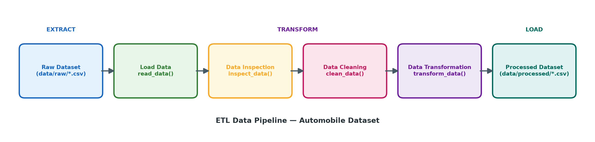
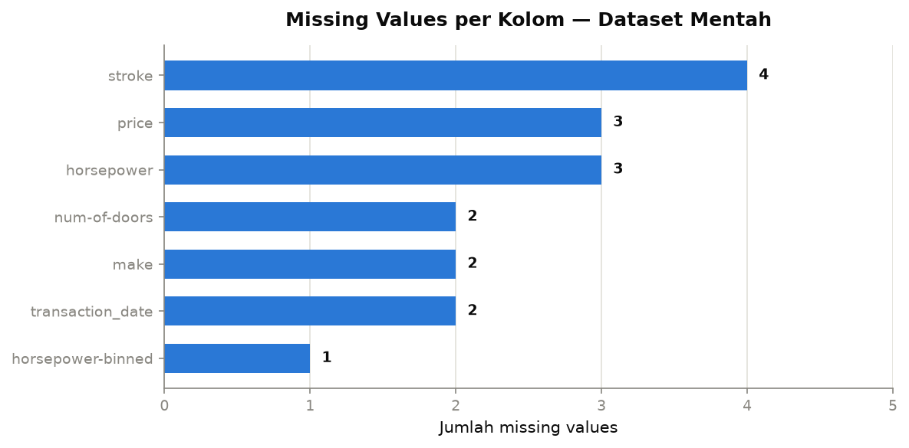
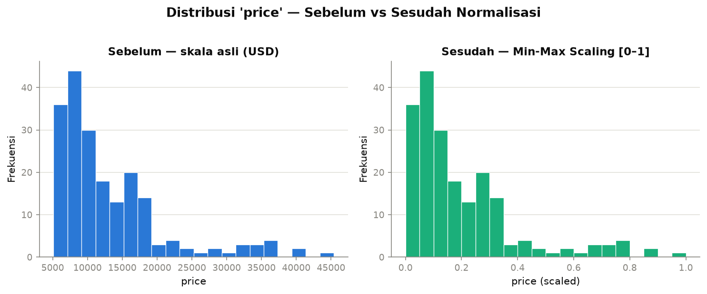
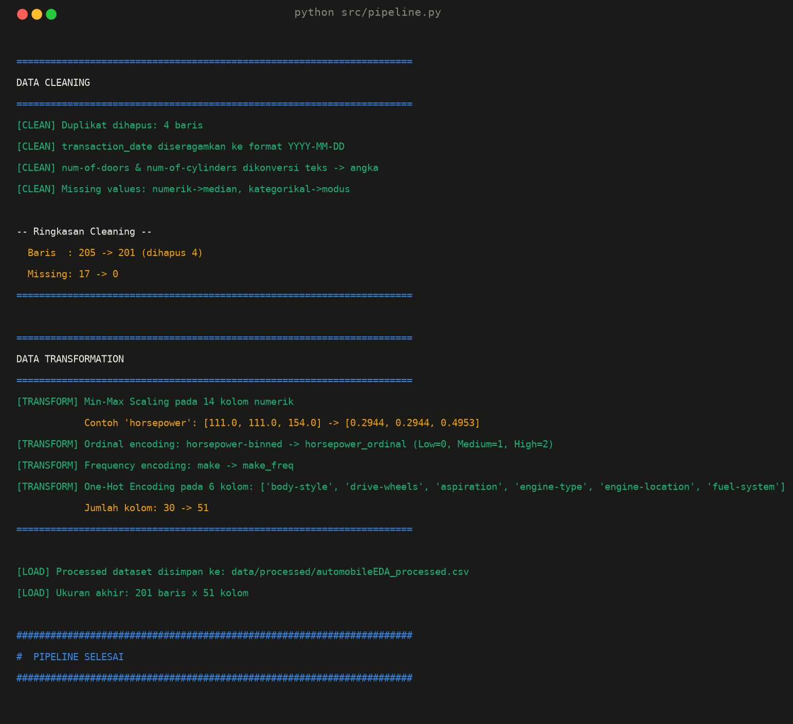

# Data Pipeline — Automobile Dataset (ETL)


Pipeline ETL menggunakan **Python + Pandas + NumPy** untuk mengolah dataset
otomotif mentah menjadi *processed dataset* yang siap dipakai pada tahap analisis
atau pemodelan berikutnya. Dilengkapi **unit test (pytest)** dan **continuous
integration (GitHub Actions)** yang menjalankan ulang pipeline pada setiap push.

### Alur Data (ETL)



```
Raw CSV → Load Data → Data Inspection → Data Cleaning → Data Transformation → Processed CSV
```

---

## 1. Deskripsi Singkat Dataset

Dataset berisi spesifikasi kendaraan (merek, dimensi, mesin, harga, konsumsi
bahan bakar, dsb). Versi mentah (`automobileEDA_dirty_training.csv`) sengaja
dibuat "kotor": mengandung *missing values*, duplikat, penulisan kategori yang
tidak konsisten, format tanggal campuran, serta kolom kategorikal berbentuk teks.

**Sumber dataset:** https://s.id/dataset-sesi-3 (`Dataset_Sesi_3.zip`)

---

## 2. Struktur Folder Project

```
data-pipeline-assignment/
├── data/
│   ├── raw/
│   │   └── automobileEDA_dirty_training.csv    # dataset mentah (input, tidak diubah)
│   └── processed/
│       └── automobileEDA_processed.csv         # output pipeline (dihasilkan otomatis)
├── src/
│   ├── pipeline.py                             # script ETL utama
│   └── generate_eda_charts.py                  # generator chart EDA (opsional)
├── tests/
│   └── test_pipeline.py                        # unit & integration tests (pytest)
├── documentation/
│   ├── data-flow-diagram.png                   # diagram alur data
│   ├── terminal-output.png                     # bukti eksekusi pipeline
│   ├── missing-values.png                      # chart missing values
│   └── scaling-before-after.png                # chart distribusi sebelum/sesudah
├── .github/workflows/ci.yml                    # continuous integration
├── README.md
└── requirements.txt
```

---

## 3. Kondisi Awal Dataset

| Aspek | Nilai |
| :---- | :---- |
| Ukuran awal | **205 baris × 30 kolom** |
| Total missing values | 17 sel |
| Duplicate records | 4 baris |

**Kolom dengan missing values:**

| Kolom | Missing |
| :---- | :---- |
| transaction_date | 2 |
| make | 2 |
| num-of-doors | 2 |
| stroke | 4 |
| horsepower | 3 |
| price | 3 |
| horsepower-binned | 1 |



---

## 4. Permasalahan yang Ditemukan

1. **Missing values** pada 7 kolom (lihat tabel di atas).
2. **Duplicate records** — 4 baris identik penuh.
3. **Penulisan kategori tidak konsisten** (huruf besar/kecil):
   - `make`: `ALFA-ROMERO`, `Audi`, `BMW` vs `alfa-romero`, `audi`, `bmw`
   - `body-style`: `SEDAN`, `Sedan`, `sedan`
   - `drive-wheels`: `AWD`, `RWD` vs `fwd`, `rwd`
   - `fuel-system`: `MPFI`, `Mpfi`, `mpfi`
4. **Whitespace berlebih** — nilai `make` seperti `dodge  `, `mercury  `, `porsche  `.
5. **Format tanggal campuran** pada `transaction_date`: `2025-01-01`, `02/01/2025`,
   `01-03-2025`, `04-Jan-2025` bercampur dalam satu kolom.
6. **Kolom kategorikal masih teks** — `num-of-doors` (two/four),
   `num-of-cylinders` (two…twelve), dan kolom nominal lain yang perlu di-*encode*.
7. **Skala numerik belum seragam** — `curb-weight`, `engine-size`, `price`,
   `horsepower`, dll masih dalam satuan asli sehingga perlu normalisasi.

---

## 5. Data Cleaning yang Dilakukan

| Permasalahan | Kolom | Metode | Alasan |
| :---- | :---- | :---- | :---- |
| Kategori tidak konsisten & whitespace | semua kolom teks | `.str.strip().str.lower()` | Menyatukan kategori yang sama agar tidak dihitung ganda saat encoding |
| Duplicate records | seluruh baris | `drop_duplicates()` | Baris identik menambah bias & tidak memberi informasi baru |
| Format tanggal campuran | `transaction_date` | Parsing multi-format → `YYYY-MM-DD` | Menyeragamkan agar dapat dianalisis konsisten |
| Kategorikal-numerik | `num-of-doors`, `num-of-cylinders` | Peta kata→angka (two→2, four→4, …) | Nilai memang bersifat numerik ordinal |
| Missing numerik | stroke, horsepower, price | Isi dengan **median** | Median tahan terhadap outlier (harga mobil sangat skewed) |
| Missing kategorikal | make, num-of-doors, horsepower-binned | Isi dengan **modus** | Nilai paling umum, tidak menambah kategori baru |
| Missing tanggal | `transaction_date` | **Dibiarkan kosong** | Data faktual/historis; tidak diimputasi agar tidak memalsukan fakta (lihat catatan di bawah) |

**Hasil:** 205 → **201 baris** (4 duplikat dihapus), missing values **17 → 0**.

> **Catatan penting — `transaction_date` (2 nilai kosong dibiarkan):**
> Kolom ini sengaja **tidak diimputasi**. Alasannya:
> 1. `transaction_date` adalah **data faktual/historis** (waktu transaksi terjadi),
>    bukan besaran statistik. Berbeda dengan `price` atau `horsepower`, tanggal
>    memiliki **satu nilai benar** yang tidak dapat "ditebak" dari median/modus
>    tanpa memalsukan fakta kejadian.
> 2. Mengisinya dengan modus/forward-fill berisiko **mengarang tanggal transaksi**
>    yang belum tentu benar, sehingga merusak keandalan data untuk audit.
> 3. Praktik data engineering yang tepat untuk *ground-truth field* yang hilang
>    adalah **mengonfirmasi ulang ke pihak penyedia data (data owner)** untuk
>    memastikan nilai sebenarnya — bukan menebak lewat imputasi statistik.
>
> Karena itu, nilai dibiarkan kosong secara jujur (*"lebih baik kosong-tapi-benar
> daripada terisi-tapi-salah"*). Kolom ini juga tidak digunakan sebagai fitur
> pemodelan, sehingga tidak memengaruhi hasil analisis.

---

## 6. Data Transformation yang Dilakukan

| Transformasi | Kolom | Metode | Alasan |
| :---- | :---- | :---- | :---- |
| **Normalisasi** | 14 kolom numerik (wheel-base, curb-weight, engine-size, horsepower, price, dll) | **Min-Max Scaling** `(x−min)/(max−min)` | Menyeragamkan skala ke rentang 0–1 agar tidak ada fitur yang mendominasi |
| **Ordinal encoding** | `horsepower-binned` → `horsepower_ordinal` | Low=0, Medium=1, High=2 | Kategori memiliki urutan (ordinal) |
| **One-Hot encoding** | body-style, drive-wheels, aspiration, engine-type, engine-location, fuel-system | `pd.get_dummies()` | Kategori nominal tanpa urutan; menghindari asumsi urutan palsu |
| **Frequency encoding** | `make` → `make_freq` | Proporsi kemunculan tiap merek | Kardinalitas tinggi (22 merek); one-hot akan membuat terlalu banyak kolom |

### Contoh Nilai Sebelum & Sesudah Transformasi

**Min-Max Scaling** (`horsepower`):

| Sebelum | Sesudah |
| :---- | :---- |
| 111.0 | 0.2944 |
| 111.0 | 0.2944 |
| 154.0 | 0.4953 |

**Min-Max Scaling** (`price`):

| Sebelum | Sesudah |
| :---- | :---- |
| 13495.0 | 0.2080 |
| 16500.0 | 0.2826 |

Perhatikan bahwa Min-Max Scaling **hanya mengubah rentang sumbu (menjadi 0–1)
tanpa mengubah bentuk distribusi** — pola sebaran data tetap sama:



**One-Hot Encoding** (`body-style` = `convertible`):

| body-style_convertible | body-style_hatchback | body-style_sedan | … |
| :----: | :----: | :----: | :----: |
| 1 | 0 | 0 | … |

**Kolom baru yang dihasilkan:** `horsepower_ordinal`, `make_freq`, dan kolom
one-hot (`body-style_*`, `drive-wheels_*`, `aspiration_*`, `engine-type_*`,
`engine-location_*`, `fuel-system_*`).

---

## 7. Jumlah Data Sebelum & Sesudah Diproses

| Tahap | Baris | Kolom |
| :---- | :----: | :----: |
| Raw dataset | 205 | 30 |
| Setelah cleaning | 201 | 30 |
| Processed dataset (setelah transform) | **201** | **51** |

---

## 8. Cara Menjalankan

### Instal dependency
```bash
pip install -r requirements.txt
```

### Jalankan pipeline
```bash
python src/pipeline.py
```

Seluruh hasil pemeriksaan awal, ringkasan cleaning, dan ringkasan transformasi
akan ditampilkan di terminal. Processed dataset dihasilkan **otomatis**.

Contoh keluaran nyata saat pipeline dijalankan:



### Jalankan test
```bash
pytest -v
```

Terdapat **15 unit & integration test** yang memvalidasi output pipeline
(jumlah baris, tidak ada missing di kolom kritikal, skala numerik dalam [0, 1],
serta kebenaran hasil encoding).

### (Opsional) Regenerasi chart EDA
```bash
python src/generate_eda_charts.py
```

---

## 9. Penjelasan Singkat Alur ETL

| Tahap | Proses |
| :---- | :---- |
| **Extract** | `read_data()` — membaca `data/raw/automobileEDA_dirty_training.csv` |
| **Transform** | `inspect_data()` → `clean_data()` → `transform_data()` — inspeksi, cleaning, dan transformasi |
| **Load** | `save_data()` — menyimpan hasil ke `data/processed/` |

`run_pipeline()` merangkai kelima fungsi tersebut menjadi satu eksekusi
end-to-end (lihat diagram alur di bagian atas README).

---

## 10. Lokasi Processed Dataset

```
data/processed/automobileEDA_processed.csv
```

Dataset mentah di `data/raw/` **tidak diubah** — pipeline hanya membaca, dan
seluruh hasil ditulis sebagai file baru di `data/processed/`.

---

## Testing & Continuous Integration

| Aspek | Keterangan |
| :---- | :---- |
| **Unit test** | `tests/test_pipeline.py` — 15 test (pytest) memvalidasi cleaning, scaling, encoding, dan output end-to-end |
| **CI** | `.github/workflows/ci.yml` — setiap `push`/`pull_request` ke `main` otomatis menjalankan pipeline + test di GitHub Actions |

CI memastikan pipeline **selalu dapat dijalankan tanpa error** dan output tetap
sesuai skema — bukan sekadar berjalan di mesin lokal.

---

## Kredit

Proyek ini dikerjakan sebagai bagian dari **Rework Academy — AI Engineering
Bootcamp**, sesi *Data Engineering: Pipeline & Preparation*. Dataset otomotif
(`automobileEDA`) disediakan sebagai materi latihan pada sesi tersebut.
