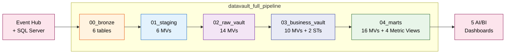
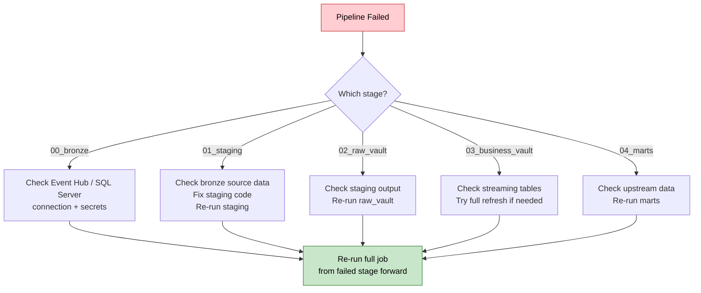
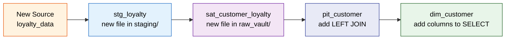

# Data Vault 2.1 — Operational Runbook

> Step-by-step guide for operating, monitoring, troubleshooting, and extending the Data Vault 2.1 restaurant chain analytics platform. Written for new team members.

---

## Table of Contents

1. [Quick Start](#1-quick-start)
2. [Architecture at a Glance](#2-architecture-at-a-glance)
3. [Pipeline Operations](#3-pipeline-operations)
4. [Monitoring & Health Checks](#4-monitoring--health-checks)
5. [Troubleshooting](#5-troubleshooting)
6. [Data Quality Investigation](#6-data-quality-investigation)
7. [Common Maintenance Tasks](#7-common-maintenance-tasks)
8. [Extending the Vault](#8-extending-the-vault)
9. [Table Dependency Map](#9-table-dependency-map)
10. [Key SQL Queries](#10-key-sql-queries)
11. [DABs Bundle Operations](#11-dabs-bundle-operations)
12. [Glossary](#12-glossary)

---

## 1. Quick Start

### Prerequisites

- Databricks workspace access (Unity Catalog enabled)
- Read access to `restaurant_chain_db` catalog
- Permission to run jobs and pipelines

### Run the Full Pipeline

1. Navigate to **Workflows** → **Jobs** → **datavault_full_pipeline**
2. Click **Run now**
3. Monitor: 5 sequential tasks execute in order

```
00_bronze_ingestion → 01_staging → 02_raw_vault → 03_business_vault → 04_marts
```

Typical runtime: 5–15 minutes (development mode, serverless compute).

### Verify Success

```sql
-- Quick table count sanity check per layer
SELECT '01_bronze' AS layer, COUNT(*) AS tables
FROM restaurant_chain_db.information_schema.tables WHERE table_schema = '01_bronze'
UNION ALL
SELECT 'staging', COUNT(*)
FROM restaurant_chain_db.information_schema.tables WHERE table_schema = 'staging'
UNION ALL
SELECT 'raw_vault', COUNT(*)
FROM restaurant_chain_db.information_schema.tables WHERE table_schema = 'raw_vault'
UNION ALL
SELECT 'business_vault', COUNT(*)
FROM restaurant_chain_db.information_schema.tables WHERE table_schema = 'business_vault'
UNION ALL
SELECT 'marts', COUNT(*)
FROM restaurant_chain_db.information_schema.tables WHERE table_schema = 'marts';
-- Expected: 01_bronze 6, staging 6, raw_vault 14, business_vault 11, marts 20+
-- (01_bronze gained order_rejections, the audit table for bad Event Hub messages)
```

---

## 2. Architecture at a Glance



| Task | Pipeline Name | Schema | Tables | Rows |
| --- | --- | --- | --- | --- |
| 00_bronze_ingestion | `datavault_bronze_ingestion` | `01_bronze` | 6 | — |
| 01_staging | `datavault_staging` | `staging` | 6 | 148,511 |
| 02_raw_vault | `datavault_raw_vault` | `raw_vault` | 14 | 185,464 |
| 03_business_vault | `datavault_business_vault` | `business_vault` | 12 | 297,999 |
| 04_marts | `datavault_marts` | `marts` | 20 | 303,852 |
| **Total** | | | **58** | **935,826+** |

> **Note**: Pipeline IDs are managed by DABs and regenerate on each deployment. Always reference pipelines by **name** in the UI. Use `databricks pipelines list` to find current IDs.

---

## 3. Pipeline Operations

### 3.1 Normal Incremental Run

Navigate to **Workflows** → **datavault_full_pipeline** → **Run now**.

All 5 pipelines use `fullRefresh: false`. Materialized views process only changed upstream rows.

### 3.2 Full Refresh (After Schema Changes)

When table structures change (new columns, renamed fields), each pipeline must be fully refreshed **in order**:

1. Open **Pipelines** → find pipeline by name
2. Click **Start** → toggle **Full refresh all tables**
3. Run in order:

```
datavault_bronze_ingestion → Full refresh → Wait
datavault_staging → Full refresh → Wait
datavault_raw_vault → Full refresh → Wait
datavault_business_vault → Full refresh → Wait
datavault_marts → Full refresh → Wait
```

### 3.3 Running Individual Pipelines

For debugging, run a single stage. Open the pipeline by name in the Pipelines UI and click **Start**.

> **Warning**: Running a downstream pipeline without running upstream first may produce stale results. Always run from the failed stage forward.

### 3.4 Pipeline Execution Order Rule

```
ALWAYS: bronze → staging → raw_vault → business_vault → marts
NEVER:  Skip a stage or run out of order
```

---

## 4. Monitoring & Health Checks

### 4.1 Data Freshness

```sql
SELECT
  table_schema AS layer,
  table_name,
  table_type,
  ROUND(TIMESTAMPDIFF(HOUR, last_altered, CURRENT_TIMESTAMP()), 1) AS hours_since_update,
  CASE
    WHEN TIMESTAMPDIFF(HOUR, last_altered, CURRENT_TIMESTAMP()) <= 2 THEN 'FRESH'
    WHEN TIMESTAMPDIFF(HOUR, last_altered, CURRENT_TIMESTAMP()) <= 24 THEN 'RECENT'
    ELSE 'STALE'
  END AS freshness
FROM restaurant_chain_db.information_schema.tables
WHERE table_schema IN ('01_bronze', 'staging', 'raw_vault', 'business_vault', 'marts')
  AND LEFT(table_name, 2) != '__'
ORDER BY last_altered DESC;
```

### 4.2 Row Count Baselines

```sql
SELECT 'hub_customer' AS tbl, COUNT(*) AS rows FROM restaurant_chain_db.raw_vault.hub_customer
UNION ALL SELECT 'hub_order', COUNT(*) FROM restaurant_chain_db.raw_vault.hub_order
UNION ALL SELECT 'hub_restaurant', COUNT(*) FROM restaurant_chain_db.raw_vault.hub_restaurant
UNION ALL SELECT 'hub_review', COUNT(*) FROM restaurant_chain_db.raw_vault.hub_review
UNION ALL SELECT 'hub_menu_item', COUNT(*) FROM restaurant_chain_db.raw_vault.hub_menu_item
UNION ALL SELECT 'fact_order', COUNT(*) FROM restaurant_chain_db.marts.fact_order
UNION ALL SELECT 'fact_review', COUNT(*) FROM restaurant_chain_db.marts.fact_review
UNION ALL SELECT 'dim_customer', COUNT(*) FROM restaurant_chain_db.marts.dim_customer
UNION ALL SELECT 'dim_restaurant', COUNT(*) FROM restaurant_chain_db.marts.dim_restaurant;
```

**Expected baselines**:

| Table | Expected | Notes |
| --- | --- | --- |
| hub_customer | 504 | Unique customer business keys |
| hub_order | 36,961 | Unique orders (after dedup) |
| hub_restaurant | 6 | 5 active + 1 test |
| hub_review | 84 | All reviews including orphans |
| hub_menu_item | 150 | 30 items × 5 restaurants (composite key) |
| fact_order | 36,961 | Matches hub_order |
| fact_review | 82 | 84 minus 2 orphans dropped by INNER JOIN |
| dim_customer | 505 | 504 real + 1 ghost record |
| dim_restaurant | 7 | 6 real + 1 ghost record |

### 4.3 DQ Expectation Monitoring

```sql
-- Query pipeline event log for DQ pass/fail counts
SELECT
  row_exp.dataset,
  row_exp.name AS expectation,
  SUM(row_exp.passed_records) AS passed,
  SUM(row_exp.failed_records) AS failed
FROM (
  SELECT explode(
    from_json(
      details:flow_progress:data_quality:expectations,
      'array<struct<name:string, dataset:string, passed_records:int, failed_records:int>>'
    )
  ) AS row_exp
  FROM event_log(TABLE(restaurant_chain_db.raw_vault.hub_customer))
  WHERE event_type = 'flow_progress'
)
GROUP BY row_exp.dataset, row_exp.name
ORDER BY row_exp.dataset;
```

---

## 5. Troubleshooting

### 5.1 Common Errors

| Error | Cause | Fix |
| --- | --- | --- |
| `TABLE_OR_VIEW_NOT_FOUND: staging.stg_orders` | Upstream pipeline hasn't run yet | Run pipelines from bronze forward in order |
| `EXPECT_ALL_OR_FAIL` pipeline halt | NULL business key in source data | Check bronze: `SELECT * FROM 01_bronze.orders WHERE order_id IS NULL` |
| `DeltaStreamingSourceOffset` error | Streaming table state corrupted | Full refresh on business_vault pipeline |
| Stale dashboard data | Pipelines ran but dashboards not refreshed | Click Refresh on dashboard; check warehouse is running |
| `ai_query` timeout in business_vault | AI model endpoint slow or unavailable | Retry pipeline; `sat_review_sentiment` is streaming (auto-retries) |
| Hash key mismatch between layers | Hashing inconsistency | Verify `_dv_hash.py` is identical across all pipeline folders |
| `Table is already managed by pipeline <id>` | **Pipeline ownership conflict** — another pipeline (workspace or DABs) owns the table | Delete the conflicting pipeline via REST API (`cascade=false`), drop affected MVs, redeploy. See §5.4 |
| `bundle validate` fails on `warehouse_id` | Missing `BUNDLE_VAR_warehouse_id` | Set env var: `BUNDLE_VAR_warehouse_id="<id>"`. Find ID at SQL Warehouses → Connection Details |
| `DATABRICKS_HOST` not set | CLI can't determine workspace | Set `DATABRICKS_HOST` env var or run `databricks auth login --host <url>` |
| `INSUFFICIENT_PERMISSIONS` on metric views / dashboards | Metric view owner lacks SELECT on SP-owned tables | Schema-level GRANT SELECT runs automatically in task `05_apply_permissions`. Manual fix: `GRANT SELECT ON SCHEMA restaurant_chain_db.marts TO \`account users\`` |
| `PERMISSION_DENIED: User does not have BROWSE on Catalog` | Service principal lacks Unity Catalog permissions | Run as catalog admin: `GRANT ALL PRIVILEGES ON CATALOG restaurant_chain_db TO \`<sp-application-id>\`;` See §11.6 |

### 5.2 Pipeline Failure Recovery



**Key principle**: Each pipeline is idempotent. Re-running is always safe. Materialized views recompute; streaming tables resume from last checkpoint.

### 5.3 Tracing an Order Through All Layers

Use this pattern to debug any data issue by following a specific record end-to-end:

```sql
-- 1. Staging: verify hash keys were computed
SELECT hk_order, hk_customer, hk_restaurant, order_id, total_amount
FROM restaurant_chain_db.staging.stg_orders
WHERE order_id = 'ORD-12345';

-- 2. Hub: verify business key was registered
SELECT * FROM restaurant_chain_db.raw_vault.hub_order
WHERE order_id = 'ORD-12345';

-- 3. Satellite: verify attribute history (all versions)
SELECT h.order_id, s.order_type, s.total_amount, s.payment_method, s.load_dts
FROM restaurant_chain_db.raw_vault.sat_order_header s
JOIN restaurant_chain_db.raw_vault.hub_order h ON s.hk_order = h.hk_order
WHERE h.order_id = 'ORD-12345'
ORDER BY s.load_dts;

-- 4. PIT: verify effective dating
SELECT p.effective_from, p.effective_to, p.order_type, p.total_amount
FROM restaurant_chain_db.business_vault.pit_order p
JOIN restaurant_chain_db.raw_vault.hub_order h ON p.hk_order = h.hk_order
WHERE h.order_id = 'ORD-12345';

-- 5. Bridge: verify relationship resolution
SELECT * FROM restaurant_chain_db.business_vault.bridge_order
WHERE order_id = 'ORD-12345';

-- 6. Mart fact: verify final output
SELECT * FROM restaurant_chain_db.marts.fact_order
WHERE order_id = 'ORD-12345';
```

### 5.4 Pipeline Ownership Conflict Resolution

Unity Catalog allows only **one pipeline** to own each streaming table or materialized view. When migrating from workspace pipelines to DABs (or redeploying with new pipeline IDs), you may hit:

```
Table `restaurant_chain_db`.`01_bronze`.`menu_items` is already managed by pipeline <old-id>
```

**Resolution**:

```python
# 1. Delete the conflicting pipeline (preserves tables as "inactive")
import requests
host = spark.conf.get("spark.databricks.workspaceUrl")
token = dbutils.notebook.entry_point.getDbutils().notebook().getContext().apiToken().get()
headers = {"Authorization": f"Bearer {token}"}

old_pipeline_id = "<old-pipeline-id-from-error-message>"
resp = requests.delete(
    f"https://{host}/api/2.0/pipelines/{old_pipeline_id}",
    headers=headers
)
print(f"Deleted: {resp.status_code}")

# 2. Drop affected MVs (they recreate on next pipeline run)
# spark.sql("DROP MATERIALIZED VIEW IF EXISTS restaurant_chain_db.`01_bronze`.menu_items")

# 3. Re-run the DABs pipeline — it claims ownership on first run
```

> **Prevention**: Before deploying DABs to a workspace with existing pipelines, always delete the old pipelines first. Use `cascade=false` (default) to preserve the underlying table data.

---

## 6. Data Quality Investigation

### 6.1 Ghost Record Verification

```sql
-- Ghost records ensure referential integrity for late-arriving/orphan data
SELECT 'dim_customer' AS dim, customer_id, name
FROM restaurant_chain_db.marts.dim_customer WHERE customer_id = 'UNKNOWN'
UNION ALL
SELECT 'dim_restaurant', restaurant_id, restaurant_name
FROM restaurant_chain_db.marts.dim_restaurant WHERE restaurant_id = 'UNKNOWN';
```

### 6.2 Orphan Review Detection

```sql
-- Reviews in raw vault that don't appear in mart fact_review
SELECT h.review_id, 'orphan - order not found' AS reason
FROM restaurant_chain_db.raw_vault.hub_review h
LEFT JOIN restaurant_chain_db.marts.fact_review fr ON h.review_id = fr.review_id
WHERE fr.review_id IS NULL;
-- Expected: 2 orphan reviews (REV-079, REV-080)
```

### 6.3 Hash Key Integrity

```sql
-- Verify all hash keys are valid 64-char SHA-256 hex strings
SELECT 'hub_customer' AS tbl, COUNT(*) AS invalid_keys
FROM restaurant_chain_db.raw_vault.hub_customer
WHERE LENGTH(hk_customer) != 64 OR hk_customer RLIKE '[^0-9a-f]'
UNION ALL
SELECT 'hub_order', COUNT(*)
FROM restaurant_chain_db.raw_vault.hub_order
WHERE LENGTH(hk_order) != 64 OR hk_order RLIKE '[^0-9a-f]';
-- Expected: 0 invalid for all tables
```

### 6.4 Satellite Duplicate Check

```sql
-- Satellites should have exactly one row per (parent_hk, hash_diff)
SELECT hk_customer, hash_diff, COUNT(*) AS dupes
FROM restaurant_chain_db.raw_vault.sat_customer
GROUP BY hk_customer, hash_diff
HAVING COUNT(*) > 1;
-- Expected: 0 rows (no duplicates)
```

---

## 7. Common Maintenance Tasks

### 7.1 Refresh All Dashboards

Dashboards auto-refresh on data change. For manual refresh:
1. Open each dashboard in the Dashboards UI
2. Click the refresh button
3. Verify KPIs match expected values (see §4.2 baselines)

### 7.2 Add a New DQ Expectation

1. Open the relevant `.py` file in the appropriate `transformations/` folder
2. Add an expectation decorator:

```python
# WARN only (monitor, don't block)
@dp.expect("new_rule_name", "column_name IS NOT NULL")

# FAIL (halt pipeline on violation)
@dp.expect_or_fail("critical_rule", "pk_column IS NOT NULL")

# DROP (silently remove invalid rows)
@dp.expect_all_or_drop({"rule1": "col1 IS NOT NULL", "rule2": "col2 > 0"})
```

3. Re-run the pipeline (no full refresh needed for `expect` warn rules)

### 7.3 Update Metric Views

Metric views are SQL DDL objects, not managed by pipelines. Update them directly:

```sql
CREATE OR REPLACE METRIC VIEW restaurant_chain_db.marts.sales_operations_metrics
AS SELECT ...
```

---


### 7.4 Apply Governance Tags (Post-Deployment)

After initial pipeline deployment or schema changes, run the governance SQL to apply Unity Catalog tags and column comments:

```sql
-- Execute scripts/set_tags_for_governance.sql in a SQL editor or notebook
-- Applies:
--   - Schema-level tags (layer, data_owner)
--   - Table-level tags (pii, data_classification)
--   - Column-level PII tags (pii_type, masking)
--   - Column comments for data catalog discoverability
```

**When to run**: Once after initial deployment, then after any schema/table structure changes.

**Verification**: Run the governance tag audit query from `scripts/monitoring_queries.sql` (Query 5) to confirm all tags are applied.

### 7.5 Verify Liquid Clustering & Retention

All vault and mart tables should have:
- `cluster_by` on their primary/foreign key columns
- `delta.deletedFileRetentionDuration: interval 30 days`
- `delta.logRetentionDuration: interval 90 days`

```sql
-- Check table properties for a specific table
SHOW TBLPROPERTIES restaurant_chain_db.raw_vault.hub_customer;

-- Look for: delta.deletedFileRetentionDuration, delta.logRetentionDuration
-- And liquid clustering config
```

---

## 8. Extending the Vault

### 8.1 Adding a New Source (e.g., Loyalty System)



**Steps**:

1. **Bronze**: Ingest new source into `01_bronze`
2. **Staging**: Create `stg_loyalty.py` — compute `hk_customer` using `hash_key()` from `_dv_hash.py`
3. **Raw Vault**: Create `sat_customer_loyalty.py` — FK = `hk_customer`, attributes = tier, points
4. **Business Vault**: Update `pit_customer.py` — add LEFT JOIN to new satellite
5. **Marts**: Update `dim_customer.py` — add new columns to SELECT
6. **Deploy**: `databricks bundle deploy --target dev --force` (or push to main for CI/CD)

**What stays untouched**: `hub_customer`, `sat_customer`, `lnk_order`, `bridge_order`, all other PITs, all facts and aggregates.

### 8.2 Adding a New Entity (e.g., Suppliers)

1. **Staging**: Create `stg_suppliers.py` — compute `hk_supplier`
2. **Raw Vault**: Create `hub_supplier.py` + `sat_supplier.py` + optionally `lnk_restaurant_supplier.py`
3. **Business Vault**: Create `pit_supplier.py` + optionally `bridge_restaurant_supplier.py`
4. **Marts**: Create `dim_supplier.py` + update relevant aggregates
5. **Pipeline YMLs**: Add new `.py` file paths to the `libraries` section of the relevant pipeline YMLs in `resources/`
6. **Deploy**: Push to main or `databricks bundle deploy`

### 8.3 Adding a New Aggregate

1. Create `agg_new_metric.py` in `src/marts/transformations/agg/`
2. Source from existing mart facts/dims — no vault layer changes needed
3. Add the file path to `resources/marts_pipeline.yml` under `libraries`
4. Optionally create a metric view for BI consumption
5. Deploy via DABs

---

## 9. Table Dependency Map

### Mart-Level Dependencies

| Mart Table | Depends On |
| --- | --- |
| `dim_customer` | pit_customer, hub_customer |
| `dim_restaurant` | pit_restaurant, hub_restaurant |
| `dim_menu_item` | pit_menu_item, hub_menu_item |
| `dim_date` | ref_date_dim |
| *(governance)* | ref_record_source (record source registry) |
| `fact_order` | bridge_order, pit_order, dim_restaurant, dim_customer, bridge_order_item |
| `fact_order_item` | bridge_order_item, pit_order_item, dim_menu_item, dim_restaurant |
| `fact_review` | hub_review, lnk_review_order, hub_order, pit_review, sat_review_sentiment, dim_restaurant |
| `agg_restaurant_performance_daily` | fact_order |
| `agg_customer_360` | fact_order |
| `agg_menu_item_performance_monthly` | fact_order_item |
| `agg_review_insights_monthly` | fact_review |
| `agg_business_monthly_base` | agg_restaurant_performance_daily |
| `agg_business_performance_trends` | agg_business_monthly_base |
| `agg_menu_item_ranked_monthly` | agg_menu_item_performance_monthly |
| `feat_customer_features` | fact_order |
| `feat_restaurant_demand_features` | agg_restaurant_performance_daily |

### Cross-Layer Dependency Chain

```
Event Hub / SQL Server
  └→ 01_bronze.orders (ST)
      └→ staging.stg_orders
          ├→ raw_vault.hub_order
          ├→ raw_vault.hub_customer (also from stg_customers)
          ├→ raw_vault.hub_restaurant (also from stg_restaurants)
          ├→ raw_vault.lnk_order
          ├→ raw_vault.sat_order_header
          │    └→ business_vault.pit_order
          │         └→ marts.fact_order
          │              └→ marts.agg_restaurant_performance_daily
          │                   └→ marts.sales_operations_metrics (metric view)
          └→ staging.stg_order_items
               ├→ raw_vault.hub_menu_item
               ├→ raw_vault.lnk_order_item
               ├→ raw_vault.sat_order_item
               │    └→ business_vault.pit_order_item
               │         └→ marts.fact_order_item
               │              └→ marts.agg_menu_item_performance_monthly
               └→ business_vault.bridge_order_item
```

---

## 10. Key SQL Queries

### Revenue Verification

```sql
SELECT ROUND(SUM(total_revenue), 2) AS revenue,
       SUM(total_orders) AS orders,
       ROUND(SUM(total_revenue) / SUM(total_orders), 2) AS aov
FROM restaurant_chain_db.marts.agg_restaurant_performance_daily;
-- Expected: AED 6,558,708.27 | 36,961 | AED 177.45
```

### Channel & Payment Mix

```sql
SELECT
  ROUND(SUM(dine_in_orders) * 100.0 / SUM(total_orders), 2) AS dine_in_pct,
  ROUND(SUM(takeaway_orders) * 100.0 / SUM(total_orders), 2) AS takeaway_pct,
  ROUND(SUM(delivery_orders) * 100.0 / SUM(total_orders), 2) AS delivery_pct,
  ROUND((SUM(card_orders) + SUM(wallet_orders)) * 100.0 / SUM(total_orders), 2) AS digital_pct
FROM restaurant_chain_db.marts.agg_restaurant_performance_daily;
-- Expected: 33.28% | 33.12% | 33.60% | 66.51%
```

### Customer Count Across Layers

```sql
SELECT 'hub_customer' AS layer, COUNT(*) AS cnt
FROM restaurant_chain_db.raw_vault.hub_customer
UNION ALL SELECT 'pit_customer', COUNT(*)
FROM restaurant_chain_db.business_vault.pit_customer
UNION ALL SELECT 'dim_customer', COUNT(*)
FROM restaurant_chain_db.marts.dim_customer
UNION ALL SELECT 'agg_customer_360', COUNT(*)
FROM restaurant_chain_db.marts.agg_customer_360;
-- Expected: 504 | 504 | 505 (ghost) | 503
```

### Satellite Change History

```sql
-- How many attribute versions exist per customer?
SELECT h.customer_id, COUNT(*) AS versions
FROM restaurant_chain_db.raw_vault.sat_customer s
JOIN restaurant_chain_db.raw_vault.hub_customer h ON s.hk_customer = h.hk_customer
GROUP BY h.customer_id
HAVING COUNT(*) > 1
ORDER BY versions DESC;
```

### Using Metric Views

```sql
-- Metric views use MEASURE() syntax for auto-aggregation at query time
SELECT restaurant_name,
       MEASURE(total_revenue) AS revenue,
       MEASURE(total_orders) AS orders
FROM restaurant_chain_db.marts.sales_operations_metrics
GROUP BY restaurant_name
ORDER BY revenue DESC;
```

---

## 11. DABs Bundle Operations

The project is deployed as a **Databricks Declarative Automation Bundle (DABs)** with GitHub Actions CI/CD.

### 11.1 Local Development

```bash
# Authenticate (one-time)
databricks auth login --host https://<workspace-url>

# Validate bundle
BUNDLE_VAR_warehouse_id="<warehouse-id>" \
databricks bundle validate --target dev

# Deploy
BUNDLE_VAR_warehouse_id="<warehouse-id>" \
databricks bundle deploy --target dev --force

# Run the orchestration job
databricks bundle run datavault_full_pipeline --target dev

# Run a single pipeline
databricks bundle run datavault_staging --target dev

# Destroy all deployed resources (CAUTION)
databricks bundle destroy --target dev
```

### 11.2 CI/CD (GitHub Actions)

| Trigger | Action |
| --- | --- |
| Pull request to `main` | `bundle validate` (checks YAML syntax, variable resolution) |
| Push/merge to `main` | `bundle deploy --target dev --force` (deploys all resources) |

Required GitHub Secrets:

| Secret | Purpose |
| --- | --- |
| `DATABRICKS_HOST` | Workspace URL (auth + targeting) |
| `DATABRICKS_CLIENT_ID` | Service principal client ID |
| `DATABRICKS_CLIENT_SECRET` | SP OAuth secret |
| `NOTIFICATION_EMAIL` | Job failure alert email |
| `WAREHOUSE_ID` | SQL warehouse ID for dashboards |

### 11.3 Finding Your Warehouse ID

New teams cloning the repo need a SQL warehouse ID for dashboard deployment:

1. **UI**: SQL Warehouses → select a warehouse → **Connection Details** → copy the HTTP path, extract the ID after `/sql/1.0/warehouses/`
2. **CLI**: `databricks warehouses list --output JSON` → look for the `id` field
3. **URL**: When viewing a warehouse, the URL contains the ID: `.../sql/warehouses/<warehouse-id>`

### 11.4 Secrets Scope Management

Runtime credentials live in a **Databricks secrets scope** (not in bundle variables or GitHub secrets):

```bash
# Create scope (one-time)
databricks secrets create-scope res-chain-pipeline

# Add runtime secrets
databricks secrets put-secret res-chain-pipeline eh-conn-str --string-value "<Event-Hub-Connection-String>"
databricks secrets put-secret res-chain-pipeline db_admin_username --string-value "<SQL-Server-Username>"
databricks secrets put-secret res-chain-pipeline db_admin_password --string-value "<SQL-Server-Password>"

# Grant service principal read access
databricks secrets put-acl res-chain-pipeline <sp-application-id> READ
```

### 11.5 Adding a New Pipeline File

When you add a `.py` transformation file:

1. Create the file in `src/<layer>/transformations/`
2. Add it to the `libraries` section of the corresponding `resources/<layer>_pipeline.yml`
3. Commit, push to main → CI/CD deploys automatically


### 11.6 Service Principal Unity Catalog Permissions

The service principal used by GitHub Actions CI/CD needs Unity Catalog permissions to run pipelines. Without these, you get:

```
PERMISSION_DENIED: User does not have BROWSE on Catalog 'restaurant_chain_db'
```

**Grant permissions** (run as catalog admin — your personal user, not the SP):

```sql
-- Option 1: Grant all privileges (recommended for dev)
GRANT ALL PRIVILEGES ON CATALOG restaurant_chain_db TO `<sp-application-id>`;

-- Option 2: Granular grants (recommended for prod)
GRANT USE CATALOG ON CATALOG restaurant_chain_db TO `<sp-application-id>`;
GRANT USE SCHEMA ON CATALOG restaurant_chain_db TO `<sp-application-id>`;
GRANT BROWSE ON CATALOG restaurant_chain_db TO `<sp-application-id>`;
GRANT CREATE TABLE ON CATALOG restaurant_chain_db TO `<sp-application-id>`;
GRANT CREATE MATERIALIZED VIEW ON CATALOG restaurant_chain_db TO `<sp-application-id>`;
GRANT SELECT ON CATALOG restaurant_chain_db TO `<sp-application-id>`;
GRANT MODIFY ON CATALOG restaurant_chain_db TO `<sp-application-id>`;
```

Replace `<sp-application-id>` with the service principal's application (client) ID — the same value stored in the `DATABRICKS_CLIENT_ID` GitHub secret.

**Verify grants**:

```sql
SHOW GRANTS ON CATALOG restaurant_chain_db;
```

---


### 11.7 Security Groups (Account-Level)

Unity Catalog uses **account-level groups** for access control. These must be created in the **Databricks Account Console** (not the workspace admin page).

#### Group Model

| Group | Access | Members |
| --- | --- | --- |
| `datavault-admins` | ALL PRIVILEGES on catalog | Pipeline SP, workspace admins |
| `datavault-engineers` | SELECT on all 5 schemas | Data engineers (debugging/development) |
| `datavault-analysts` | SELECT on `marts` schema only | Dashboard viewers, BI analysts |

#### Creating Groups

**Option A: Account Console (UI)**

1. Log in to the [Databricks Account Console](https://accounts.azuredatabricks.net)
2. Navigate to **User Management** → **Groups** → **Add group**
3. Create: `datavault-admins`, `datavault-engineers`, `datavault-analysts`
4. Add members to each group

**Option B: Account-Level SCIM API (from workspace)**

```bash
# Create group (workspace admin can use workspace URL)
curl -X POST "https://<workspace-url>/api/2.0/account/scim/v2/Groups" \
  -H "Authorization: Bearer <token>" \
  -H "Content-Type: application/json" \
  -d '{"displayName": "datavault-analysts", "schemas": ["urn:ietf:params:scim:schemas:core:2.0:Group"]}'

# Add member to group
curl -X PATCH "https://<workspace-url>/api/2.0/account/scim/v2/Groups/<group-id>" \
  -H "Authorization: Bearer <token>" \
  -H "Content-Type: application/json" \
  -d '{"schemas": ["urn:ietf:params:scim:api:messages:2.0:PatchOp"], "Operations": [{"op": "add", "value": {"members": [{"value": "<user-scim-id>"}]}}]}'
```

**Option C: Azure Entra ID (Enterprise)**

Sync groups from Azure AD via SCIM provisioning. See [Databricks SCIM docs](https://learn.microsoft.com/azure/databricks/admin/users-groups/scim/).

#### Permission Inheritance

Schema-level `GRANT SELECT` automatically applies to **all current and future tables** in that schema. When pipelines recreate materialized views, the new tables inherit the grant — no per-table re-granting needed.

#### Important Notes

- **Account-level groups only**: Unity Catalog does NOT recognize workspace-level groups. Groups created via `{workspace}/api/2.0/preview/scim/v2/Groups` will fail in GRANT statements with `PRINCIPAL_DOES_NOT_EXIST`.
- **Metric view DEFINER security**: Metric views execute as their OWNER (SQL SECURITY DEFINER). The view owner must be in `datavault-analysts` or `datavault-engineers` to access underlying tables.
- **Grants are applied in CI/CD** (`deploy.yml`) after `databricks bundle deploy`. Schema-level grants persist across table recreation — they only need to run once after deployment, not after every data refresh.
- **To apply grants manually** (e.g., first-time setup without CI/CD), run `scripts/apply_grants.sql` in a SQL editor.

---

## 12. Glossary

| Term | Definition |
| --- | --- |
| **Hub** | Table storing unique business keys (e.g., customer_id). One row per entity, insert-only. |
| **Link** | Table storing relationships between hubs (e.g., order ↔ customer ↔ restaurant). |
| **Satellite** | Table storing descriptive attributes with hash-diff change detection. Append-only — new row per attribute change. |
| **PIT** | Point-in-Time table. Adds `effective_from` / `effective_to` to satellite rows for temporal queries. |
| **Bridge** | Pre-joined hub relationships for query acceleration. Resolves hash keys to natural business keys. |
| **Hash Key (hk_)** | SHA-256 hash of salted business key(s). Used as PK/FK across all vault layers. |
| **Hash Diff** | SHA-256 hash of all descriptive attributes. Used by satellites to detect changes between loads. |
| **Ghost Record** | Synthetic "UNKNOWN" row in dimensions for referential integrity with late-arriving or orphan data. |
| **MV** | Materialized View — incrementally refreshed by Lakeflow Spark Declarative Pipelines. |
| **ST** | Streaming Table — processes data incrementally via structured streaming. |
| **Lean PIT** | PIT with one row per satellite version (not per calendar date). Dramatically smaller than classic PITs. |
| **Computed Satellite** | Satellite with derived/enriched data (e.g., AI sentiment analysis via `ai_query`). |
| **SDP** | Spark Declarative Pipelines (formerly Delta Live Tables / DLT). |
| **DABs** | Declarative Automation Bundles — Databricks' infrastructure-as-code framework for deploying jobs, pipelines, and dashboards from a Git repo. |
| **Bundle Variable** | Parameterized value in `databricks.yml` referenced as `${var.name}`. Can have defaults or require external input via `BUNDLE_VAR_name` env vars. |
| **Secrets Scope** | Databricks-managed key vault for storing sensitive runtime credentials (connection strings, passwords). Accessed via `dbutils.secrets.get()`. |
| **OAuth M2M** | OAuth machine-to-machine authentication using a service principal. Recommended for CI/CD — no personal access tokens. |
